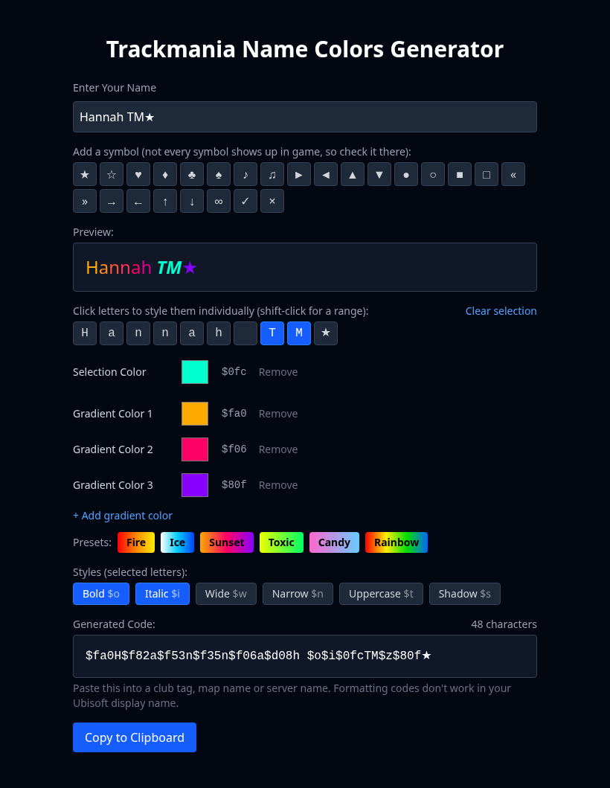

# 🎨 Trackmania Name Colors Generator 🎨

**Try it: https://hannahconnolly.github.io/trackmania-name-gen/**

A lightweight web tool that lets you create colorful, styled names for **Trackmania**, including support for gradients, symbols, and formatting codes — all with real-time preview and one-click copy.



## 🌟 Features
- 🎯 Input your desired name
- 🟥 Solid colors or gradients with up to 4 color stops (`$f00`-style codes), plus gradient presets
- 🔤 Style toggles: bold `$o`, italic `$i`, wide `$w`, narrow `$n`, uppercase `$t`, shadow `$s`
- 🖱️ Per-letter styling: select letters to give them their own color and styles
- ⭐ Symbol picker (not every symbol shows up in game, so check it there)
- 👁️ Real-time preview rendered from the generated code
- 📋 One-click "Copy to Clipboard"
- 💻 Built with Next.js (App Router) + Tailwind CSS
- ⚡️ Deployed to GitHub Pages on every push to `main`

The generated code goes into a club tag, map name or server name. Formatting codes don't work in your Ubisoft display name.

> Inspired by:  
> - [Trackmania Text Styling Wiki](https://wiki.trackmania.io/en/content-creation/text-styling)  
> - [KC Name Tool](https://kc.jfreu.com/)

## 🛠️ Getting Started

```bash
git clone https://github.com/HannahConnolly/trackmania-name-gen.git
cd trackmania-name-gen
npm install
npm run dev
```
